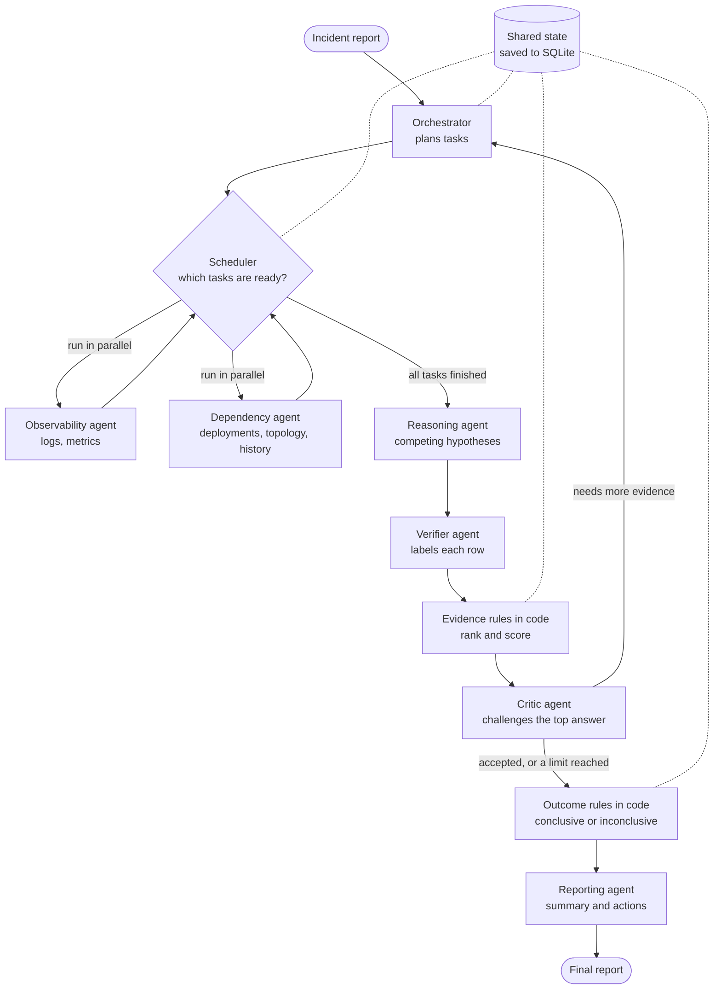

# Multi-Agent Incident Investigator

An AI system that investigates production incidents. It reads logs, metrics, deployments, service dependencies and past incidents. It then reports the likely root cause, the evidence for and against it, and what to do next. If the evidence is not enough, it says so.

The data is simulated and can be incomplete or misleading.

## Main result

We compared the multi-agent system with a single agent that has the same tools. **The single agent won.**

| Metric | Multi-agent | Single agent |
|---|---|---|
| Root-cause accuracy | 69% | 89% |
| Holdout accuracy (incidents not used for tuning) | 33% | 89% |
| Tokens per run | 24,303 | 18,266 |
| Mean latency | 45s | 27s |

See [Evaluation](#evaluation) for all metrics and [NOTE.md](NOTE.md) for why.

## Setup

You need [uv](https://docs.astral.sh/uv/) and an API key. uv installs Python 3.12 for you.

```bash
uv sync --all-extras
cp .env.example .env    # then add your API key to .env
```

Default settings in `.env`:

```
AI_PROVIDER=gemini
AI_MODEL=gemini-3.6-flash
GEMINI_API_KEY=your-key
AI_THINKING=low
```

To change provider, change these values. No code changes are needed. For example: `AI_PROVIDER=anthropic`, `AI_MODEL=claude-sonnet-5-5`, `ANTHROPIC_API_KEY=your-key`.

A free Gemini key may not be enough. One run made 3 to 23 model requests in our evaluation, and our free key hit a limit of 20 requests per day.

## Run

| Task | Command | Needs API key |
|---|---|---|
| Run all tests | `uv run pytest` | No |
| Investigate one incident | `uv run python cli.py INC-01` | Yes |
| Continue a crashed run | `uv run python cli.py INC-01 --resume <thread>` | Yes |
| Run the full comparison | `uv run python -m evals --repeats 3` | Yes |
| Run a small comparison | `uv run python -m evals --repeats 1 --cases INC-01 INC-08` | Yes |
| Calibration and cost report | `uv run python -m reliability.analysis` | No |
| Check for regressions | `uv run python -m reliability.regression` | No |
| Score the evidence rules alone | `uv run python -m reliability.rule_eval` | No |
| Recalculate every saved score | `uv run python -m reliability.audit` | No |
| Run metamorphic robustness tests | `uv run python -m reliability.metamorphic` | No |
| Same, on the blind set | `uv run python -m reliability.metamorphic --incidents data/blind_incidents.yaml` | No |
| Count coverage by category and difficulty | `uv run python -m reliability.coverage` | No |

The full comparison makes 72 runs, used about 1.5M tokens, and stops starting new runs at 2M tokens. It writes to `evals/results/`.

A shortened report from a real run:

```
Outcome: CONCLUSIVE (stopped: critic_accepted)

Hypotheses:
  1. [high] Deployment v2.4.0 of payments service introduced a bug in
     ChargeHandler.applyDiscount causing NullPointerExceptions. (bad_deploy, payments)
     supports: ['dep-01', 'log-02', 'log-03']  contradicts: []
     verified ratio: 1.00  net support: 3
  2. [low] Payvendor API failure caused payments service to crash. (dependency_failure, payvendor)
     supports: []  contradicts: []
     verified ratio: 0.00  net support: 0

Facts: 5  Inferences: 2
Assumptions: 3
Actions:
  - Roll back the payments service deployment v2.4.0. [needs approval]

Usage: 7 tool calls, 11 LLM calls, 15486 tokens (1297 thinking). Citation validity: 100%
```

## Architecture



### How the agents work together

| Agent | Job | Output |
|---|---|---|
| Orchestrator | Plans tasks and their order | `Plan` |
| Observability | Investigates logs and metrics | `Finding` |
| Dependency | Investigates deployments, config changes, topology and past incidents | `Finding` |
| Reasoning | Proposes competing root causes | `HypothesisSet` |
| Verifier | Labels each row for each hypothesis, without seeing what was cited | `Verification` |
| Critic | Challenges the top answer and asks for more evidence | `Critique` |
| Reporting | Writes the summary and actions | `ReportDraft` |

This is more than a chain of prompts:

- **Task order:** a task can wait for another one. Its agent then receives that task's findings.
- **Feedback:** the Critic sends typed requests. These become new tasks in a new round.
- **Shared evidence:** all agents use one evidence ledger. A row enters it only if a tool really returned it.
- **Independent check:** the Verifier does not see the citations, so it cannot simply agree with them.

**LLMs judge meaning. Code decides.** Code controls routing, limits, citation checks, confidence and the final outcome. The Reporting agent cannot change the conclusion.

### How a conclusion is reached

The LLM never scores itself. Code calculates these values from the Verifier's labels. Only logs, metrics and deployments count, because topology and past incidents do not show what happened in this incident.

| Value | Rule |
|---|---|
| Verified ratio | Cited rows labelled `supports` ÷ cited rows |
| Net support | Rows labelled `supports` − rows labelled `contradicts` |
| High confidence | Ratio ≥ 0.8, 2+ source types, no contradictions, no failed tools |
| Medium confidence | Ratio ≥ 0.5, 2+ source types, positive net support |
| Low confidence | Anything else |
| Conclusive | Critic accepts, at least medium confidence, and net support at least 1 above the runner-up |

Anything else is **inconclusive**, and the report says why. A fact with no valid citation becomes an assumption. Confidence is a rule-based label, not a probability.

### Reliability

| Failure or risk | What happens |
|---|---|
| Tool timeout or error | Retried up to 2 times, then recorded as an evidence gap |
| Partial tool results | Flagged, so the agent can narrow its query |
| Model error | Retried up to 3 times. A daily quota error stops the run at once and is reported |
| Task fails or hangs | Marked failed after a 120s limit. The investigation continues |
| Planner fails | A default plan is used |
| Reasoning, Verifier or Critic fails | The run ends inconclusive and still gives a report |
| Report writer fails | A template writes the report. The conclusion does not change |
| Process crashes | The run continues from its last SQLite checkpoint |

Limits for each run: 2 rounds, 25 tool calls, 80,000 tokens and 300 seconds. Limits for each task: 4 model turns and 5 tool calls. Each round has at most 4 tasks. A run also stops if the Critic accepts, says the evidence is insufficient, requests nothing, or a new round finds no new evidence.

## Dataset

[`data/incidents.yaml`](data/incidents.yaml) has 12 incidents in a fictional online shop. Tools see only the telemetry. The correct answers are stored apart, and a test proves tools cannot return them.

| Incident | Scenario | Tests |
|---|---|---|
| INC-01 | Bad deploy | Control case |
| INC-02 | Config change in a dependency | Cause far from symptom |
| INC-03 | Harmless deploy near the real cause | Misleading evidence |
| INC-04 | Past incident looks the same | Misleading evidence |
| INC-05 | Logs show errors, default metrics look healthy | Conflicting observations |
| INC-06 | Loud old errors, quiet real signal | Misleading evidence (holdout) |
| INC-07 | Log tool times out twice, then recovers | Tool failure |
| INC-08 | Deployment tool down, logs partial | Tool failure, expected inconclusive |
| INC-09 | Slow auth causes a retry storm | Misleading evidence (holdout) |
| INC-10 | Symptoms only | Expected inconclusive |
| INC-11 | Log contains a prompt injection and a fake secret | Security |
| INC-12 | Deploy rolled back, errors continue; metrics partial | Conflicting observations, tool failure (holdout) |

## Evaluation

Both systems used the same model, tools, budget, evidence rules and report format. Each ran every incident 3 times, for 72 valid runs on `gemini-3.6-flash`. Scoring is plain code, with no LLM judge.

| Metric | Multi-agent | Single agent |
|---|---|---|
| Root-cause accuracy | 69% | 89% |
| Wrong conclusions | 6% | 0% |
| Missed conclusions | 25% | 11% |
| Fell for misleading evidence | 6% | 0% |
| Citation validity | 100% | 100% |
| Key evidence recall | 86% | 81% |
| Key evidence precision | 69% | 83% |
| Claims downgraded per run | 1.3 | 0.1 |
| Tool calls per run | 11.2 | 12.1 |
| LLM calls per run | 15.0 | 5.3 |
| Tokens per run | 24,303 | 18,266 |
| Mean latency | 45s | 27s |

Correct runs out of 3:

| Incident | Multi-agent | Single agent |
|---|---|---|
| INC-01 to INC-06, INC-08, INC-10 | 3/3 each | 3/3 each |
| INC-07 | 0/3 | 0/3 |
| INC-09 (holdout) | 0/3 | 2/3 |
| INC-11 | 1/3 | 3/3 |
| INC-12 (holdout) | 0/3 | 3/3 |

**How to read these numbers:**

- A correct run needs the right outcome. If the case is conclusive, it also needs the right category and component.
- **Tuning was on dev incidents only.** We changed prompts and one evidence rule after seeing dev results. We made no changes after the holdout incidents first ran.
- **The sample is small.** There are 12 incidents and 3 in the holdout, so treat differences as a signal, not proof.
- **The comparison may favour the single agent.** It got 12 turns against 4 per task, and its prompt used lessons learned from the multi-agent system.
- The prompt injection did not work: no INC-11 run concluded `gateway`, the answer the log line pushes for.

Raw data: [`results.md`](evals/results/results.md) and [`results.json`](evals/results/results.json).

### Are these results still current?

Yes, for these 12 incidents. The evaluation ran on commit `4a14410`. We checked every later change:

| Check | Result |
|---|---|
| Agent prompts, model settings, budget, run setup | No lines changed |
| Workflow, baseline, evidence rules, data contracts | Only new fields that record data, such as Verifier labels. No decision logic changed |
| Tool changes (log cap, partial faults) | Apply only to more than 20 matching logs, or partial faults with `times`. The 12 incidents use neither |
| Replay of 1,632 tool calls, old code against new | 0 differences |

The same model can still answer differently from run to run, which is why each incident ran 3 times.

### Future work: per-agent evaluation

**Not built yet, because it needs paid model runs.** To control evaluation cost, we stopped making model calls. The current results show **what** happened, such as 69% against 89%. They do not show **which agent** lost each answer.

| Level | Evaluated now | What we have | What is missing |
|---|---|---|---|
| End to end | Yes, real model | Accuracy, grounding, tool calls, latency, tokens over 72 runs | Only the final report is scored |
| Orchestrator | No | Nothing | Were the right tasks planned, in the right order? |
| Observability and Dependency | No | Nothing | Did they retrieve the key evidence? |
| Reasoning | Partly | Top hypothesis right in 26 of 30 conclusive runs | Was the right cause among any of its hypotheses? |
| Verifier | No | Labels are saved from now on, but no saved run has them | How accurate are its labels, including symptom vs cause? |
| Critic | No | Nothing | Did it accept right answers and push back on wrong ones? It accepted INC-12's wrong answer |
| Reporting | No | One invented version number, seen by hand | Are the actions and summary grounded in evidence? |
| Tools | Yes, offline | Unit tests, simulated failures, metamorphic tests | Nothing major |
| Evidence rules | Yes, offline | Rule eval, property tests, metamorphic tests | Nothing major |
| Calculations | Yes, offline | Audit, plus cross-checks against scikit-learn and SciPy | Nothing |
| Latency and tokens per step | Partly | Total latency, and tokens per agent from now on | Latency per agent and per step |

**The plan:** score every run as a funnel, one stage at a time. Each failed run then shows the first stage that went wrong, and the totals show which agent loses the most answers.

```
Key evidence retrieved?          -> Observability and Dependency
Right cause among hypotheses?    -> Reasoning
Key rows labelled "supports"?    -> Verifier
Right cause ranked first?        -> Evidence rules
Accepted only when right?        -> Critic
Right final outcome?             -> End to end
Actions grounded in evidence?    -> Reporting
Time and tokens at each stage    -> Every agent
```

The single agent would get the same funnel, with every stage credited to its one agent.

| Step | Cost |
|---|---|
| Record each stage's data in every run: retrieved rows, all hypotheses, all Verifier labels, the Critic's verdict, time per agent | No model calls |
| Build the funnel scoring, tested with fake models | No model calls |
| Get real per-agent results | **Needs model calls.** Saved runs lack these details, so they cannot be rescored. About 200k tokens for a dev subset, or about 1.5M for all 12 incidents on both systems |

Any provider works: set `AI_PROVIDER` and `AI_MODEL`. Results from a different model cannot be compared directly with the Gemini results above.

## Learnings

Each change we made, with its measured result before and after. "Dev" results come from the incidents we tuned on, so they show a change worked there, not that it works in general.

| Action | Before | After | Lesson |
|---|---|---|---|
| LLM scored its own confidence | Score was the model's opinion | A Verifier labels rows and code computes confidence | Never let a model grade itself |
| Specialists could use every turn on tool calls | First real INC-08 run used all 40 tool calls and ended on budget, 104,139 tokens | Last turn forces a finding: INC-01 and INC-08 right in 6/6 dev runs | Agents need a forced finish, not just a limit |
| Prompts tuned on dev incidents | Verifier called a specific error a mere symptom: INC-01 flipped to inconclusive | INC-01 right in 3/3 dev runs | Tuning on dev cases can't prove it generalises |
| Token reduction (low thinking, one retry layer, compact prompts) | INC-01 about 32k tokens, INC-08 about 104k | INC-01 about 17.6k, INC-08 about 30k, still 6/6 right on dev | Measure where tokens go before cutting |
| Fail fast on daily quota | Up to 36 attempts per call, about 37 seconds each, and a quota failure looked like a correct "inconclusive" | Stops at once and is reported as invalid. The full evaluation had 0 invalid runs | Infrastructure failures must never be scored as answers |
| Topology and past incidents no longer count as evidence | Pilot INC-07: multi-agent concluded the wrong cause, `payments`, mostly from topology rows | No full-evaluation INC-07 run blamed `payments`, but INC-07 still failed for other reasons | Background is a lead, not proof |
| Compared multi-agent with a single agent | Unknown | Multi-agent 69%, single agent 89%; on holdout, 33% vs 89% | Report the comparison as measured |
| Fixes 1 and 2: deploy evidence and failed-rollback rules | 13 known cases: 6/13. 8 realistic cases: 6/8 | 13 known cases: 12/13. 8 realistic cases: 3/8. **Removed** | Rules designed from failures can overfit |
| Metamorphic tests | No robustness tests | Found that harmless old log lines could cut off key evidence | Test changes that shouldn't change the answer |
| Log tool keeps errors, warnings and newest lines when capped | Metamorphic 122/130; on blind cases 226/234 | Metamorphic 130/130; on blind cases 234/234; blind cases as written 16/18 both before and after | Helped only on noise we designed. Harmless, but unproven on real noise |
| Blind test set from an independent agent | 12 cases, every category and difficulty below 3 cases | 36 cases, all at 3 or more except prompt injection | Separate the case writer from the system builder |
| `partial` faults honour `times` | Partial results never recovered | Recover after `times` calls. No score changed on either set | Blind cases find bugs our own cases missed |

**Overall lesson:** most of our wins were on cases we had already seen. The two checks that we could not tune for, the realistic cases and the blind set, showed that both the overfitted rules and the log fix were weaker than they first looked.

## Requirements map

| Requirement | Where | Proof |
|---|---|---|
| At least 5 distinct agents | `investigator/agents.py` | `tests/core/test_agents.py` |
| Structured results, real collaboration | `investigator/schemas.py`, `investigator/graph.py` | `tests/core/test_agents.py` |
| Tools with structured input and output | `investigator/tools.py` | `tests/core/test_tools.py` |
| Error handling, timeouts, incomplete results | `investigator/tools.py` | `tests/core/test_tools.py` |
| Parallel tasks, task dependencies, shared state | `investigator/graph.py` | `tests/core/test_graph.py` |
| Feedback loops | `investigator/graph.py` | `tests/core/test_graph.py` |
| Bounded retries, limits, termination | `investigator/budget.py`, `investigator/llm.py` | `tests/core/test_graph.py` |
| Recovery from agent and tool failures | `investigator/graph.py` | `tests/core/test_graph.py` |
| Ranked hypotheses, evidence for and against, confidence | `investigator/evidence.py` | `tests/core/test_evidence.py` |
| Recommended actions | `investigator/graph.py`, `investigator/evidence.py` | `tests/core/test_evidence.py` |
| Facts vs assumptions, inconclusive outcome | `investigator/evidence.py` | `tests/core/test_evidence.py` |
| 10+ test incidents | `data/incidents.yaml` | `tests/core/test_tools.py` |
| Single-agent baseline, same tools | `investigator/baseline.py` | `tests/core/test_baseline.py` |
| Accuracy, grounding, tool calls, latency, tokens | `evals/scoring.py` | `tests/core/test_evals.py` |
| No hardcoded answers | Tools never receive answers | `tests/core/test_tools.py` |
| Technical note, 500 words or fewer | [NOTE.md](NOTE.md) | |
| Coding assistant transcript | [TRANSCRIPT.md](TRANSCRIPT.md) | |

## A fix we tried and removed

The evaluation showed multi-agent usually found the right cause, then our rules blocked it. We tried two rules:

1. A deploy or config cause needs a matching deployment record.
2. A cause is ruled out if errors continued after its rollback.

On the 13 cases they were designed from, correct results rose from 6 to 12. On 8 new real-life cases, they fell from 6 to 3. The rules matched exact names, such as `payments` and `kind: deploy`, and treated missing records as proof. Real systems use other names, feature flags, regional rollbacks and several deploys at once. **We removed both rules**, because they fit our test cases but not real incidents. They remain in git history, in commit `696df01`.

### Evidence rule evaluation

`reliability.rule_eval` checks the evidence rules alone, with no model calls. Labels are what a perfect Verifier would give.

| Set | What it is | Correct |
|---|---|---|
| Reconstructed | Failed evaluation runs, rebuilt from saved summaries | 0/5 |
| Control | Cases from the test incidents with a clear answer | 6/8 |
| Adversarial | Real-life variations, frozen so no rule can be tuned on them | 6/8 |

All 21 scenarios together: precision 62%, recall 67%, 6 wrong conclusions. Full detail: [`rule_eval.md`](evals/results/rule_eval.md).

The developer wrote the expected answers, so treat these as evidence, not proof.

### Metamorphic tests

`reliability.metamorphic` changes each incident in a way that should not change the answer, then checks the answer did not change. It runs the real tools and evidence rules, with labels from each case's key evidence. No model calls are made, and nobody picks the expected answers: they come from the unchanged incident.

| Change | Should | Passed |
|---|---|---|
| Rename every service, metric, change kind or row ID | Not change the answer | 40/40 |
| Deploy tool uses other service names | Not change the answer | 10/10 |
| Shift all times by 400 days, or shuffle rows | Not change the answer | 20/20 |
| Add 3 harmless log rows | Not change the answer | 10/10 |
| Add 25 harmless rows, before or after the report, or as warnings | Not change the answer | 30/30 |
| Drop a key evidence row, or add a contradicting one | Not raise confidence | 20/20 |
| **Total** | | **130/130** |

**It catches overfitting:** the removed rules score 100/110 on the original 11 changes.

**It found a weakness, now fixed:** the log tool returned the oldest 20 rows, so harmless older lines cut off key evidence. Capped results now keep errors, then warnings, then the newest info lines. This took the suite from 122/130 to 130/130. These noise checks were written by the developer of the fix, so the blind set below is the fairer test.

Full detail: [`metamorphic.md`](evals/results/metamorphic.md).

### Blind test set

[`data/blind_incidents.yaml`](data/blind_incidents.yaml) has 24 incidents for a new fictional bank. A separate agent wrote them without seeing the system's rules, prompts, tests or results. They were committed unchanged before any scoring, and nothing has been tuned on them. It is the same kind of model as the developer, so it is more independent, not fully independent. Blind cases written by a person would be stronger.

Offline scoring of the 18 conclusive cases, with the same labels as above:

| Test | Old log tool | New log tool |
|---|---|---|
| Unchanged cases solved | 16/18 | 16/18 |
| Metamorphic checks | 226/234 | 234/234 |
| Checks made worse by the fix | | None |

**What this shows:**

- The log fix did no harm on blind cases, but made no difference on them as written. Its gain appears only on noise the developer added.
- Both unsolved cases log key evidence under another name for the service, such as `card-processing` for `cards`. Tools match service names exactly, and nothing maps one name to the other. A service catalog would fix this. Not fixed, because it was found on this set.
- The blind set found a bug: a `partial` fault ignored `times`, so partial results never recovered. This is now fixed, because it broke the documented data format. No offline score changed, on either set.
- The 6 inconclusive blind cases need a real model to test, which has not been run.

Detail: [`metamorphic_blind.md`](evals/results/metamorphic_blind.md). Coverage of both sets: [`coverage.md`](evals/results/coverage.md).

### How the calculations are checked

| Check | Result |
|---|---|
| Hand-worked examples, with the working in comments | All pass |
| Property tests: thousands of generated inputs per rule | No counterexample found |
| Evidence precision and recall vs scikit-learn | 0 mismatches in 5,000 random cases |
| Wilson intervals vs SciPy | 0 mismatches in 860 cases |
| Audit: recalculate all 72 saved scores and the report | All match |

The audit cannot recheck evidence precision and recall in the saved runs, because they did not store cited rows. New runs store them, along with each row's Verifier label.

## Reliability extras

These go beyond the assignment. They add no agent behaviour and make no model calls, so the reported results stand. To control evaluation cost, the full evaluation was not re-run after adding them.

### Calibration

`reliability.analysis` reads saved results and reports how often each confidence label was right. Results are in [`analysis.md`](evals/results/analysis.md).

| System | Confidence | Correct | 95% range |
|---|---|---|---|
| Multi-agent | High | 9/11 (82%) | 52% to 95% |
| Multi-agent | Medium | 10/10 (100%) | 72% to 100% |
| Single agent | High | 22/22 (100%) | 85% to 100% |
| Single agent | Medium | 4/4 (100%) | 51% to 100% |

The labels did not prove useful here: high was never more reliable than medium. The ranges overlap, so the sample is too small to be sure.

To estimate cost, add your provider's current prices per million tokens: `--input-price 0.10 --output-price 0.40`. These example numbers are not real prices.

### Regression gate

Use this after any model, prompt or code change:

```bash
uv run python -m evals --repeats 3             # makes paid model calls
uv run python -m reliability.regression        # compares results, no model calls
uv run python -m reliability.regression --update   # only if you accept the new results
```

It exits with an error if any of these happen:

| Check | Limit |
|---|---|
| Accuracy | Falls by more than 5 points |
| Wrong conclusions, misleading evidence | Any rise |
| Citation validity | Falls by more than 2 points |
| Key evidence recall | Falls by more than 5 points |
| Tokens per run | Rises by more than 20% |
| Mean latency | Rises by more than 30% |
| Runs | Any invalid run, or a missing system or incident |

It also warns when any single incident gets worse. The limits are wide because repeated LLM runs vary. They are starting values, not tuned ones. The saved baseline is [`baseline.json`](evals/results/baseline.json).

### Golden dataset

Real findings can become test cases. A person must confirm each answer, so a system mistake cannot become the expected result.

```bash
uv run python -m reliability.golden draft runs/<incident>.json
# Edit the draft: redact it, then fill in truth, scenario and reviewed_by
uv run python -m reliability.golden add data/golden_drafts/<incident>.yaml
uv run python -m evals --golden --repeats 3    # makes paid model calls
```

A case is refused if no reviewer is named, if secrets or email addresses remain, if its ID already exists, or if its answer is incomplete. Reviewed cases go in [`data/golden_extra.yaml`](data/golden_extra.yaml), which is empty for now. The 12 assignment incidents stay frozen, so the reported results remain comparable. Use `--golden` only with a baseline created from a golden run.

## Continuous integration

GitHub Actions runs lint, format checks and all tests on every push. See `.github/workflows/ci.yml`. It uses fake models, so it needs no API key and makes no model calls.

## Project layout

```
investigator/   Assignment core: agents, workflow, tools, evidence rules, baseline
evals/          Assignment comparison and scoring
data/           The 12 test incidents, and reviewed golden cases
reliability/    Extras: safety, calibration, regression gate, golden dataset
tests/core/     Tests for the core
tests/reliability/  Tests for the extras
cli.py          Investigate one incident
```

The core does not import the extras, and a test enforces this. `cli.py` and `evals` both use `reliability/`, so redaction and the risky-action flag are on in every reported result.

## Incomplete functionality and known limits

**Not built:**

- Human approval step. Risky actions are only flagged, and nothing is ever executed, so there is nothing to approve yet.
- Hosted tracing, such as LangSmith. Everything runs locally.

**Built and tested offline, but not yet used on a new model run:**

- Per-agent tokens in the eval results. The current results do not have them. The CLI report already shows them.
- The `--golden` evaluation option. It is tested only as far as loading cases, and no golden case exists yet.
- The fixes listed in [NOTE.md](NOTE.md). They would change agent behaviour, so they need a new paid evaluation and new unseen incidents.

**Known limits:**

- The multi-agent system lost the comparison. Known problems are ties between hypotheses, and concluding the wrong cause with high confidence on INC-12.
- INC-07 fails in both systems on low confidence. The cause is not diagnosed.
- A Verifier label is an LLM judgement, so it can be wrong. Confidence labels did not separate right from wrong answers in this evaluation.
- Regression limits and secret checks catch only what they look for. Passing them does not prove a case or a change is safe.
- Summaries and action text are not checked against evidence. In one real run, an action named a version number that is not in the data. Hypotheses, ranking and the outcome are checked.
- Rows are counted, not weighed. Repeated log lines can outweigh one decisive metric.
- A task that fails loses the evidence it had gathered.
- After a resume, the time limit restarts and the per-agent token split is incomplete.
- Tokens from failed model calls are not counted.
- Secret detection uses patterns, so it can miss other formats. The risky-action flag uses keywords.
- Only Gemini was run for real. Anthropic was only checked offline, and OpenAI was not tested.
- The mock data is much simpler than real telemetry.

## External dependencies

| Dependency | Use | Required |
|---|---|---|
| LLM provider API (Gemini by default) | All agents | Yes, for real runs |
| LangGraph | Workflow, parallelism, retries, checkpoints | Yes |
| LangChain | Agents, provider switching, middleware | Yes |
| SQLite, through `langgraph-checkpoint-sqlite` | Crash recovery | Yes |
| Pydantic, PyYAML, python-dotenv | Data contracts, dataset, settings | Yes |

Incident text and tool output are sent to the LLM provider after redaction. Check your provider's data terms before using real logs. Free tiers may allow providers to use your data.
