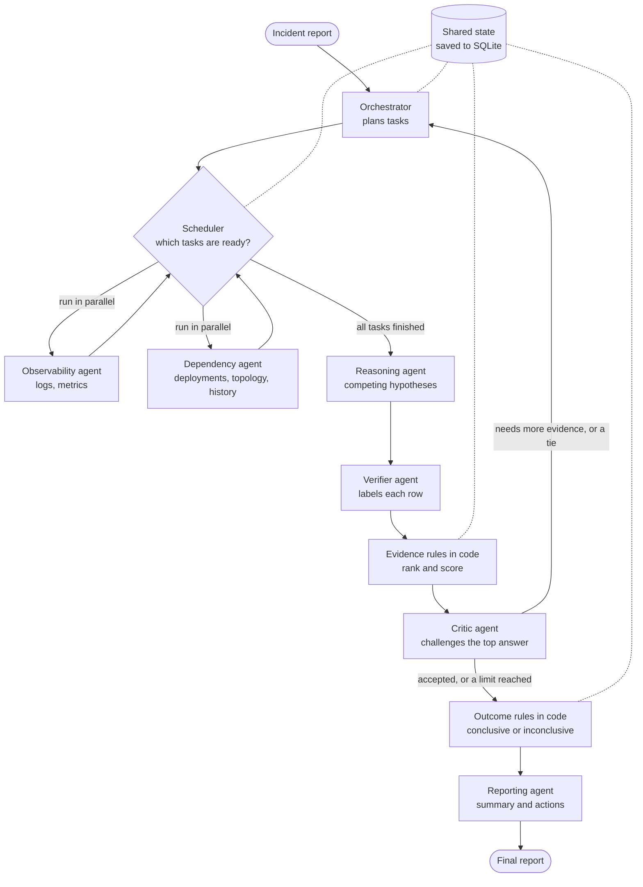

# Multi-Agent Incident Investigator

An AI system that investigates production incidents. It reads logs, metrics, deployments, service dependencies and past incidents. It reports the likely root cause, the evidence for and against it, and what to do next. When the evidence is not enough, it says so.

All data is simulated, and some of it is incomplete or misleading on purpose.

## At a glance

We compared the multi-agent system with a single agent that has the same tools, model, budget and evidence rules.

| Evaluation | Version | Multi-agent | Single agent | What it shows |
|---|---|---|---|---|
| 12 assignment incidents, 3 runs each | v1 | 69% | **89%** | The single agent was more accurate |
| 24 blind incidents, 1 run each | v2 | **75%** | 71% | A statistical tie on accuracy. Multi-agent made fewer wrong conclusions: 2 against 5 |

**In short:**

- On the assignment set, v1 multi-agent lost clearly.
- v2 added tie-breaking and shared findings. On blind cases neither system was tuned on, it tied on accuracy and was safer, but it cost about 24% more tokens and was about 46% slower.
- The two evaluations use different incidents and versions, so the change from v1 to v2 cannot be measured from them.

## Contents

1. [Quick start](#1-quick-start)
2. [How it works](#2-how-it-works)
3. [Test data](#3-test-data)
4. [Evaluation](#4-evaluation)
5. [Learnings](#5-learnings)
6. [Requirements map](#6-requirements-map)
7. [Reliability extras](#7-reliability-extras)
8. [Limitations and future work](#8-limitations-and-future-work)
9. [Project details](#9-project-details)

Also see the [technical note](NOTE.md) and the [coding assistant transcript](TRANSCRIPT.md).

## 1. Quick start

You need [uv](https://docs.astral.sh/uv/) and an API key. uv installs Python 3.12 for you.

```bash
uv sync --all-extras
cp .env.example .env    # then add your API key to .env
```

Default settings in `.env`:

```
AI_PROVIDER=gemini
AI_MODEL=gemini-3.6-flash
GEMINI_API_KEY=your-key
AI_THINKING=low
```

To change provider, change these values. No code changes are needed, for example `AI_PROVIDER=anthropic`, `AI_MODEL=claude-sonnet-5-5`, `ANTHROPIC_API_KEY=your-key`. A free Gemini key may not be enough: one run makes 3 to 23 model requests, and our free key hit a limit of 20 requests per day.

### Commands

| Task | Command | Model calls |
|---|---|---|
| Run all tests | `uv run pytest` | No |
| Investigate one incident | `uv run python cli.py INC-01` | Yes |
| Continue a crashed run | `uv run python cli.py INC-01 --resume <thread>` | Yes |
| Compare both systems on the assignment set | `uv run python -m evals --repeats 3` | Yes |
| Compare both systems on the blind set | `uv run python -m evals --incidents data/blind_incidents.yaml --repeats 1 --out evals/results/blind` | Yes |
| Score the evidence rules alone | `uv run python -m reliability.rule_eval` | No |
| Run metamorphic robustness tests | `uv run python -m reliability.metamorphic` | No |
| Same, on the blind set | `uv run python -m reliability.metamorphic --incidents data/blind_incidents.yaml` | No |
| Recalculate every saved score | `uv run python -m reliability.audit` | No |
| Calibration and cost report | `uv run python -m reliability.analysis` | No |
| Check for regressions | `uv run python -m reliability.regression` | No |
| Count coverage by category and difficulty | `uv run python -m reliability.coverage` | No |

Evaluations stop starting new runs at `--max-tokens`, 2M by default. Runs already in progress still finish.

### Sample output

A shortened report from a real run:

```
Outcome: CONCLUSIVE (stopped: critic_accepted)

Hypotheses:
  1. [high] Deployment v2.4.0 of payments service introduced a bug in
     ChargeHandler.applyDiscount causing NullPointerExceptions. (bad_deploy, payments)
     supports: ['dep-01', 'log-02', 'log-03']  contradicts: []
     verified ratio: 1.00  net support: 3
  2. [low] Payvendor API failure caused payments service to crash. (dependency_failure, payvendor)
     supports: []  contradicts: []
     verified ratio: 0.00  net support: 0

Facts: 5  Inferences: 2
Assumptions: 3
Actions:
  - Roll back the payments service deployment v2.4.0. [needs approval]

Usage: 7 tool calls, 11 LLM calls, 15486 tokens (1297 thinking). Citation validity: 100%
```

## 2. How it works



### The agents

| Agent | Job | Output |
|---|---|---|
| Orchestrator | Plans tasks and their order | `Plan` |
| Observability | Investigates logs and metrics | `Finding` |
| Dependency | Investigates deployments, config changes, topology and past incidents | `Finding` |
| Reasoning | Proposes competing root causes | `HypothesisSet` |
| Verifier | Labels each row for each hypothesis, without seeing what was cited | `Verification` |
| Critic | Challenges the top answer and asks for more evidence | `Critique` |
| Reporting | Writes the summary and actions | `ReportDraft` |

### How they work together

- **Task order:** a task can wait for another one.
- **Shared findings:** every task sees all findings so far, with the ones it depends on first.
- **Feedback:** the Critic sends typed requests, which become new tasks in a new round.
- **Tie-breaking:** if the top two causes are equally supported, both specialists are asked for evidence that only one cause explains.
- **Shared evidence:** all agents use one evidence ledger. A row enters it only if a tool really returned it.
- **Independent check:** the Verifier does not see the citations, so it cannot simply agree with them.

**LLMs judge meaning. Code decides.** Code controls routing, limits, citation checks, confidence and the final outcome. The Reporting agent cannot change the conclusion.

### How a conclusion is reached

The LLM never scores itself. Code calculates these values from the Verifier's labels. Only logs, metrics and deployments count, because topology and past incidents do not show what happened in this incident.

| Value | Rule |
|---|---|
| Verified ratio | Cited rows labelled `supports` ÷ cited rows |
| Net support | Rows labelled `supports` − rows labelled `contradicts` |
| High confidence | Ratio ≥ 0.8, 2+ source types, no contradictions, no failed tools |
| Medium confidence | Ratio ≥ 0.5, 2+ source types, positive net support |
| Low confidence | Anything else |
| Conclusive | Critic accepts, at least medium confidence, and net support at least 1 above the runner-up |

Anything else is **inconclusive**, and the report says why. A fact with no valid citation becomes an assumption. Confidence is a rule-based label, not a probability.

### Reliability

| Failure or risk | What happens |
|---|---|
| Tool timeout or error | Retried up to 2 times, then recorded as an evidence gap |
| Partial tool results | Flagged, so the agent can narrow its query |
| More than 20 matching logs | Errors and warnings are kept first, then the newest lines |
| Model error | Retried up to 3 times. A daily quota error stops the run at once and is reported as invalid |
| Task fails or hangs | Marked failed after a 120s limit. The investigation continues |
| Planner fails | A default plan is used |
| Reasoning, Verifier or Critic fails | The run ends inconclusive and still gives a report |
| Report writer fails | A template writes the report. The conclusion does not change |
| Process crashes | The run continues from its last SQLite checkpoint |

**Limits:**

| Scope | Limit |
|---|---|
| Each run | 2 rounds, 25 tool calls, 80,000 tokens, 300 seconds |
| Each task | 6 model turns, 6 tool calls |
| Each round | 4 tasks |

A run also stops if the Critic accepts, says the evidence is insufficient, requests nothing, or a new round finds no new evidence.

## 3. Test data

| Set | File | Cases | Written by | Used for tuning |
|---|---|---|---|---|
| Assignment | [`data/incidents.yaml`](data/incidents.yaml) | 12, a fictional online shop | The developer | Yes, the 9 dev cases |
| Blind | [`data/blind_incidents.yaml`](data/blind_incidents.yaml) | 24, a fictional bank | A separate agent | No |
| Golden extra | [`data/golden_extra.yaml`](data/golden_extra.yaml) | 0, for reviewed real findings | People | No |

Tools see only the telemetry. The correct answers are stored apart, and a test proves tools cannot return them.

**The blind set** was written by an agent that never saw the system's rules, prompts, tests or results. It was committed unchanged before any scoring. It is the same kind of model as the developer, so it is more independent, not fully independent.

**Assignment incidents:**

| Incident | Scenario | Tests |
|---|---|---|
| INC-01 | Bad deploy | Control case |
| INC-02 | Config change in a dependency | Cause far from symptom |
| INC-03 | Harmless deploy near the real cause | Misleading evidence |
| INC-04 | Past incident looks the same | Misleading evidence |
| INC-05 | Logs show errors, default metrics look healthy | Conflicting observations |
| INC-06 | Loud old errors, quiet real signal | Misleading evidence (holdout) |
| INC-07 | Log tool times out twice, then recovers | Tool failure |
| INC-08 | Deployment tool down, logs partial | Tool failure, expected inconclusive |
| INC-09 | Slow auth causes a retry storm | Misleading evidence (holdout) |
| INC-10 | Symptoms only | Expected inconclusive |
| INC-11 | Log contains a prompt injection and a fake secret | Security |
| INC-12 | Deploy rolled back, errors continue; metrics partial | Conflicting observations, tool failure (holdout) |

With both sets together, every root-cause category and difficulty type has at least 3 cases, except prompt injection, which has 1. See [`coverage.md`](evals/results/coverage.md).

## 4. Evaluation

### How scoring works

- **Same setup:** both systems use the same model (`gemini-3.6-flash`), tools, budget, evidence rules and report format. The only difference is one agent doing all the work.
- **Plain code, no LLM judge:** a correct run needs the right outcome. If the case is conclusive, it also needs the right category and component.
- **Invalid runs:** runs ended by a provider quota error are excluded and counted separately. Both evaluations had none.

### Which version produced which results

| Version | Code | Changes that affect behaviour | Results |
|---|---|---|---|
| v1 | commit `4a14410` | The original design | Assignment set, 72 runs |
| v2 | current | Tie-breaking requests, shared findings, 6 turns and 6 tool calls per task (up from 4 and 5) | Blind set, 48 runs |

Changes between v1 and the start of v2 only recorded more data. A replay of 1,632 tool calls on the assignment set gave identical output on both. So v1 results describe the code up to v2, but not v2 itself.

### v1: assignment incidents, 72 runs

| Metric | Multi-agent | Single agent |
|---|---|---|
| Root-cause accuracy | 69% | 89% |
| Holdout accuracy (3 incidents not used for tuning) | 33% | 89% |
| Wrong conclusions | 6% | 0% |
| Missed conclusions | 25% | 11% |
| Fell for misleading evidence | 6% | 0% |
| Citation validity | 100% | 100% |
| Key evidence recall | 86% | 81% |
| Key evidence precision | 69% | 83% |
| Claims downgraded per run | 1.3 | 0.1 |
| Tool calls per run | 11.2 | 12.1 |
| LLM calls per run | 15.0 | 5.3 |
| Tokens per run | 24,303 | 18,266 |
| Mean latency | 45s | 27s |

Correct runs out of 3:

| Incident | Multi-agent | Single agent |
|---|---|---|
| INC-01 to INC-06, INC-08, INC-10 | 3/3 each | 3/3 each |
| INC-07 | 0/3 | 0/3 |
| INC-09 (holdout) | 0/3 | 2/3 |
| INC-11 | 1/3 | 3/3 |
| INC-12 (holdout) | 0/3 | 3/3 |

**Where multi-agent lost:** in 26 of 30 conclusive runs its top hypothesis was right, against 29 of 30 for the single agent. In 7 of its 11 failures it had the right cause, but the outcome rules blocked it. Even if none had been blocked, it would only have tied at 89%.

**Caveats:**

- **Tuning:** prompts and one evidence rule were tuned on dev incidents. Nothing changed after the holdout incidents first ran.
- **Turns:** the single agent got 12 turns, against 4 per task for multi-agent.
- **Prompt injection:** the injected log line did not work. No INC-11 run concluded `gateway`, the answer it pushes for.

Raw data: [`results.md`](evals/results/results.md), [`results.json`](evals/results/results.json).

### v2: blind incidents, 48 runs

| Metric | Multi-agent | Single agent |
|---|---|---|
| Root-cause accuracy | 75% (18/24) | 71% (17/24) |
| Conclusive cases right | 12/18 | 13/18 |
| Inconclusive cases right | 6/6 | 4/6 |
| Wrong conclusions | 2 | 5 |
| Missed conclusions | 4 | 2 |
| Key evidence recall | 68% | 74% |
| Key evidence precision | 41% | 48% |
| Tool calls per run | 11.4 | 12.5 |
| LLM calls per run | 15.4 | 5.7 |
| Tokens per run | 29,403 | 23,672 |
| Mean latency | 38s | 26s |

**Paired by incident:**

| Comparison | Only multi-agent | Only single agent | Paired McNemar test |
|---|---|---|---|
| Right answer | 2 | 1 | p = 1.0, no real difference |
| Wrong conclusion | 0 | 3 | p = 0.25, suggestive but not proven |

**Caveats:**

- **One run per incident:** with 24 incidents, small differences can be chance.
- **No v1 baseline:** v1 multi-agent never ran on this set, so the gap cannot be credited to the v2 changes.
- **Tokens:** the run used 1.27M tokens. The 1.2M cap stops only new runs.

Raw data: [`blind/results.md`](evals/results/blind/results.md), [`blind/results.json`](evals/results/blind/results.json).

### Offline checks, with no model calls

These test the tools and evidence rules with labels a perfect Verifier would give, so they isolate the code from LLM mistakes.

**Evidence rule evaluation** (`reliability.rule_eval`): 21 scenarios, with expected answers written by the developer.

| Set | What it is | Correct |
|---|---|---|
| Reconstructed | Failed v1 runs, rebuilt from saved summaries | 0/5 |
| Control | Cases from the assignment set | 6/8 |
| Adversarial | Real-life variations, frozen so no rule can be tuned on them | 6/8 |

Detail: [`rule_eval.md`](evals/results/rule_eval.md).

**Metamorphic tests** (`reliability.metamorphic`): change each incident in a way that should not change the answer. Expected answers come from the unchanged incident, so nobody picks them.

| Change | Should | Assignment set | Blind set |
|---|---|---|---|
| Rename services, metrics, change kinds or row IDs | Not change the answer | 40/40 | 72/72 |
| Deploy tool uses other service names | Not change the answer | 10/10 | 18/18 |
| Shift times by 400 days, or shuffle rows | Not change the answer | 20/20 | 36/36 |
| Add 3 or 25 harmless log rows, before, after or as warnings | Not change the answer | 40/40 | 72/72 |
| Drop a key evidence row, or add a contradicting one | Not raise confidence | 20/20 | 36/36 |
| **Total** | | **130/130** | **234/234** |

- **Unchanged cases solved:** 10/10 on the assignment set and 16/18 on the blind set. Both unsolved blind cases log key evidence under another service name, such as `card-processing` for `cards`.
- **It catches overfitting:** two rules we later removed score only 100/110.

Detail: [`metamorphic.md`](evals/results/metamorphic.md), [`metamorphic_blind.md`](evals/results/metamorphic_blind.md).

**Calculations:**

| Check | Result |
|---|---|
| Hand-worked examples, with the working in comments | All pass |
| Property tests: thousands of generated inputs per rule | No counterexample found |
| Evidence precision and recall vs scikit-learn | 0 mismatches in 5,000 random cases |
| Wilson intervals vs SciPy | 0 mismatches in 860 cases |
| Audit: recalculate all 72 v1 scores and the report | All match |

## 5. Learnings

Each change, with its measured result before and after. "Dev" results come from incidents we tuned on, so they show a change worked there, not that it works in general.

| Action | Before | After | Lesson |
|---|---|---|---|
| LLM scored its own confidence | Score was the model's opinion | A Verifier labels rows and code computes confidence | Never let a model grade itself |
| Specialists could use every turn on tool calls | First real INC-08 run used all 40 tool calls and ended on budget, 104,139 tokens | Last turn forces a finding: INC-01 and INC-08 right in 6/6 dev runs | Agents need a forced finish, not just a limit |
| Prompts tuned on dev incidents | Verifier called a specific error a mere symptom: INC-01 flipped to inconclusive | INC-01 right in 3/3 dev runs | Tuning on dev cases cannot prove it generalises |
| Token reduction: low thinking, one retry layer, compact prompts | INC-01 about 32k tokens, INC-08 about 104k | INC-01 about 17.6k, INC-08 about 30k, still 6/6 right on dev | Measure where tokens go before cutting |
| Fail fast on daily quota | Up to 36 attempts per call, about 37s each. A quota failure looked like a correct "inconclusive" | Stops at once and is reported as invalid. Both evaluations had 0 invalid runs | Infrastructure failures must never be scored as answers |
| Topology and past incidents no longer count as evidence | Pilot INC-07: multi-agent blamed `payments`, mostly from topology rows | No v1 INC-07 run blamed `payments`, though INC-07 still failed | Background is a lead, not proof |
| v1 comparison | Unknown | Multi-agent 69%, single agent 89%; holdout 33% against 89% | Report the comparison as measured |
| Two rules for deploy evidence and failed rollbacks | 13 known cases: 6/13. 8 realistic cases: 6/8 | 13 known cases: 12/13. 8 realistic cases: 3/8. **Removed** (commit `696df01`) | Rules designed from failures can overfit |
| Metamorphic tests | No robustness tests | Found that harmless old log lines could cut off key evidence | Test changes that should not change the answer |
| Log tool keeps errors, warnings and the newest lines when capped | Metamorphic 122/130. Blind offline 226/234 | 130/130 and 234/234. Blind cases as written: 16/18 before and after | Helped only on noise we designed. Harmless, but unproven on real noise |
| Blind set from an independent agent | 12 cases, every category and difficulty below 3 | 36 cases, all at 3 or more except prompt injection | Separate the case writer from the system builder |
| `partial` faults honour `times` | Partial results never recovered | They recover after `times` calls. No score changed | Blind cases find bugs our own cases missed |
| v2: tie-breaking, shared findings, more turns | v1 on the assignment set: 69% against 89%. Not run on the blind set | Blind set: 75% against 71% (p = 1.0). Wrong conclusions 2 against 5 | Multi-agent became safer, not clearly more accurate |

**Overall lesson:** most early wins were on cases we had already seen. The checks we could not tune for, the realistic cases and the blind set, showed which changes were weaker than they first looked.

## 6. Requirements map

| Requirement | Where | Proof |
|---|---|---|
| At least 5 distinct agents | `investigator/agents.py` | `tests/core/test_agents.py` |
| Structured results, real collaboration | `investigator/schemas.py`, `investigator/graph.py` | `tests/core/test_agents.py`, `tests/core/test_graph.py` |
| Tools with structured input and output | `investigator/tools.py` | `tests/core/test_tools.py` |
| Error handling, timeouts, incomplete results | `investigator/tools.py` | `tests/core/test_tools.py` |
| Parallel tasks, task dependencies, shared state | `investigator/graph.py` | `tests/core/test_graph.py` |
| Feedback loops | `investigator/graph.py` | `tests/core/test_graph.py` |
| Bounded retries, limits, termination | `investigator/budget.py`, `investigator/llm.py` | `tests/core/test_graph.py` |
| Recovery from agent and tool failures | `investigator/graph.py` | `tests/core/test_graph.py` |
| Ranked hypotheses, evidence for and against, confidence | `investigator/evidence.py` | `tests/core/test_evidence.py` |
| Recommended actions | `investigator/graph.py`, `investigator/evidence.py` | `tests/core/test_evidence.py` |
| Facts vs assumptions, inconclusive outcome | `investigator/evidence.py` | `tests/core/test_evidence.py` |
| 10+ test incidents | `data/incidents.yaml`, `data/blind_incidents.yaml` | `tests/core/test_tools.py` |
| Single-agent baseline, same tools | `investigator/baseline.py` | `tests/core/test_baseline.py` |
| Accuracy, grounding, tool calls, latency, tokens | `evals/scoring.py` | `tests/core/test_evals.py` |
| No hardcoded answers | Tools never receive answers | `tests/core/test_tools.py` |
| Technical note, 500 words or fewer | [NOTE.md](NOTE.md) | `tests/core/test_tools.py` |
| Coding assistant transcript | [TRANSCRIPT.md](TRANSCRIPT.md) | |

## 7. Reliability extras

These go beyond the assignment and make no model calls.

### Calibration

`reliability.analysis` reports how often each confidence label was right, from the v1 results. See [`analysis.md`](evals/results/analysis.md).

| System | Confidence | Correct | 95% range |
|---|---|---|---|
| Multi-agent | High | 9/11 (82%) | 52% to 95% |
| Multi-agent | Medium | 10/10 (100%) | 72% to 100% |
| Single agent | High | 22/22 (100%) | 85% to 100% |
| Single agent | Medium | 4/4 (100%) | 51% to 100% |

High was never more reliable than medium, so the labels did not prove useful here. The ranges overlap, so the sample is too small to be sure. To estimate cost, pass your provider's current prices per million tokens, for example `--input-price 0.10 --output-price 0.40`. These example numbers are not real prices.

### Regression gate

```bash
uv run python -m evals --repeats 3                 # makes model calls
uv run python -m reliability.regression            # compares, no model calls
uv run python -m reliability.regression --update   # only if you accept the new results
```

| Check | Fails when |
|---|---|
| Accuracy | Falls by more than 5 points |
| Wrong conclusions, misleading evidence | Any rise |
| Citation validity | Falls by more than 2 points |
| Key evidence recall | Falls by more than 5 points |
| Tokens per run | Rise by more than 20% |
| Mean latency | Rises by more than 30% |
| Runs | Any invalid run, or a missing system or incident |

It also warns when any single incident gets worse. The limits are starting values, not tuned ones. The saved baseline, [`baseline.json`](evals/results/baseline.json), holds the v1 assignment results. Only compare results from the same test set.

### Golden dataset

Reviewed real findings can become test cases. A person must confirm each answer, so a system mistake cannot become the expected result.

```bash
uv run python -m reliability.golden draft runs/<incident>.json
# Edit the draft: redact it, then fill in truth, scenario and reviewed_by
uv run python -m reliability.golden add data/golden_drafts/<incident>.yaml
uv run python -m evals --golden --repeats 3        # makes model calls
```

A case is refused if no reviewer is named, if secrets or email addresses remain, if its ID already exists, or if its answer is incomplete.

## 8. Limitations and future work

### Known limits

- **Accuracy:** multi-agent lost on v1 and only tied on v2, while costing more tokens and time.
- **Small samples:** 12 assignment and 24 blind incidents. The blind set ran once per incident.
- **Service names:** tools match names exactly, and nothing maps `card-processing` to `cards`. A service catalog would fix this, but it needs a new blind set to prove it.
- **Verifier labels** are LLM judgements and can be wrong. Confidence labels did not separate right from wrong answers.
- **Evidence is counted, not weighed:** repeated log lines can outweigh one decisive metric.
- **Report text is not checked:** summaries and actions are not checked against evidence. One real run named a version number that is not in the data.
- **Recovery gaps:**
    - a task that fails loses the evidence it had gathered;
    - after a resume, the time limit restarts and the per-agent token split is incomplete;
    - tokens from failed model calls are not counted.
- **Pattern-based safety:** secret detection uses patterns, and the risky-action flag uses keywords. They catch only what they look for.
- **Providers:** only Gemini ran for real. Anthropic was checked offline only, and OpenAI was not tested.
- **Mock data** is much simpler than real telemetry.

### Not built

- **Human approval:** risky actions are only flagged, and nothing is ever executed.
- **Hosted tracing,** such as LangSmith. Everything runs locally.

### Future work: per-agent evaluation

**Not built, because it needs model runs.** To control evaluation cost, we stopped making model calls. The results show what happened, but not which agent lost each answer.

| Level | Evaluated now | What is missing |
|---|---|---|
| End to end | Yes, real model | Only the final report is scored |
| Orchestrator | No | Were the right tasks planned, in the right order? |
| Observability and Dependency | No | Did they retrieve the key evidence? |
| Reasoning | Partly: top hypothesis right in 26 of 30 v1 runs | Was the right cause among any of its hypotheses? |
| Verifier | No: labels are saved from v2 on | How accurate are its labels? |
| Critic | No | Did it accept right answers and push back on wrong ones? |
| Reporting | No | Are actions and summary grounded in evidence? |
| Tools, evidence rules, calculations | Yes, offline | Nothing major |
| Latency and tokens per step | Partly: tokens per agent from v2 on | Latency per agent and per step |

**The plan:** score every run as a funnel, so each failed run shows the first stage that went wrong:

```
Key evidence retrieved?          -> Observability and Dependency
Right cause among hypotheses?    -> Reasoning
Key rows labelled "supports"?    -> Verifier
Right cause ranked first?        -> Evidence rules
Accepted only when right?        -> Critic
Right final outcome?             -> End to end
Actions grounded in evidence?    -> Reporting
Time and tokens at each stage    -> Every agent
```

| Step | Cost |
|---|---|
| Record each stage's data and build the funnel scoring, tested with fake models | No model calls |
| Get real per-agent results | Model calls: about 200k tokens for a dev subset, or about 1.5M for all 12 incidents on both systems |

Any provider works, but results from a different model cannot be compared directly with these Gemini results.

### Other next steps

- A service catalog, tested on a new blind set.
- Run v1 on the blind set, to measure what the v2 changes did.
- Blind incidents written by a person.

## 9. Project details

### Layout

```
investigator/       Assignment core: agents, workflow, tools, evidence rules, baseline
evals/              Comparison and scoring
data/               Assignment, blind and golden test sets
reliability/        Extras: safety, offline evals, calibration, regression gate, golden dataset
tests/core/         Tests for the core
tests/reliability/  Tests for the extras
cli.py              Investigate one incident
```

The core does not import the extras, and a test enforces this. `cli.py` and `evals` both use `reliability/`, so redaction and the risky-action flag are on in every reported result.

### Continuous integration

GitHub Actions runs lint, format checks and all tests on every push, using fake models. It needs no API key and makes no model calls. See `.github/workflows/ci.yml`.

### External dependencies

| Dependency | Use | Required |
|---|---|---|
| LLM provider API (Gemini by default) | All agents | Yes, for real runs |
| LangGraph | Workflow, parallelism, retries, checkpoints | Yes |
| LangChain | Agents, provider switching, middleware | Yes |
| SQLite, through `langgraph-checkpoint-sqlite` | Crash recovery | Yes |
| Pydantic, PyYAML, python-dotenv | Data contracts, test sets, settings | Yes |

Incident text and tool output are sent to the LLM provider after redaction. Check your provider's data terms before using real logs, because free tiers may allow providers to use your data.
